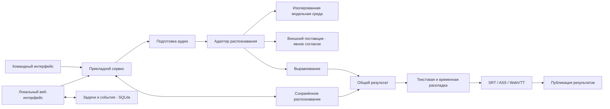

# Архитектура

Командный и локальный веб-интерфейсы обращаются к одному прикладному сервису.
Общий результат распознавания — Transcript — отделяет содержание и временные якоря от раскладки и форматов.

Схема обработки и границ ответственности:

| Компонент                  | Ответственность и граница                                                                   |
|----------------------------|---------------------------------------------------------------------------------------------|
| Интерфейсы                 | Выбор входов и настроек, наблюдение результата; не создают отдельный конвейер распознавания |
| Прикладной сервис          | Порядок обработки, повторное использование результата и согласованная публикация            |
| Подготовка аудио           | Чтение исходных медиа, выбор дорожки и рабочее аудио; оригиналы остаются вне записи         |
| Адаптеры и модельные среды | Распознавание и выравнивание через общий результат; несовместимые зависимости изолированы   |
| Раскладка и форматы        | Содержание Transcript и якоря преобразуются в субтитры без изменения исходного результата   |
| Локальный веб-сервис       | Подготовка, состояние задачи и события; постоянное состояние отдельно от страницы           |
| Кеш и публикация           | Совместимость повторного результата и сохранность форматных артефактов                      |
| Внешний поставщик          | Отдельная граница передачи аудио, разрешённая выбранным облачным режимом                    |

Схема задаёт потоки и ответственность. Конкретные условия пропуска этапов, доступа и отказа находятся у владельцев ниже.

## Владельцы контрактов

| Область                                                           | Единственный источник полных требований                             |
|-------------------------------------------------------------------|---------------------------------------------------------------------|
| Входы, аудиопоток, обход и подготовка                             | [media-preparation](../specs/media-preparation/spec.md)             |
| Движки, модели, устройство, выравнивание и облако                 | [speech-recognition](../specs/speech-recognition/spec.md)           |
| Содержание, временная раскладка и форматная структура             | [subtitle-layout](../specs/subtitle-layout/spec.md)                 |
| Кеш, force, совместимость и публикация результатов                | [recognition-artifacts](../specs/recognition-artifacts/spec.md)     |
| Локальный веб-процесс, подготовка, восстановление и история задач | [local-web-workflow](../specs/local-web-workflow/spec.md)           |
| Публичные параметры, маршруты, поля и состояния интерфейсов       | [application-interface](../specs/application-interface/spec.md)     |
| Среды, зависимости, границы проверок и техническая приёмка        | [engineering-constraints](../specs/engineering-constraints/spec.md) |

Публичные параметры и состояния — в [спецификации интерфейсов](../specs/application-interface/spec.md);
рабочие процедуры — в [README](../../README.md#подготовка-сред).
[ADR](ADR/README.md) сохраняют причины выбора; [примеры](examples/README.md) — связи реализации и проверок.
